# Getting started: run your first golf day

A short walkthrough for the person who organises the golf - the secretary, treasurer,
or whoever got volunteered. No technical knowledge needed, and nothing here requires a
golfer to belong to a golf club.

**Time:** about 20 minutes of setup before your first day; about 5 minutes per day after
that. Everything you type is saved as you go, so you can stop and come back.

> New to the app? Open it in a browser. On the demo deployment the sign-in page lists
> three ready-made accounts - the one marked *site admin* sees the same screens you will.

---

## Before you start

Have these to hand:

| You need | Why |
| --- | --- |
| An email address and a password | Your organiser login |
| The society's name (and home club, if it has one) | The badge everything hangs off |
| The names of the people who play | You can add them as you go - nothing is locked in |
| The course you are playing next | Search for it, or type the card in |
| Roughly how handicaps are known | Club/WHS numbers, a society handicap, or "no handicap yet" - all fine |

---

## 1. Sign in and make the society

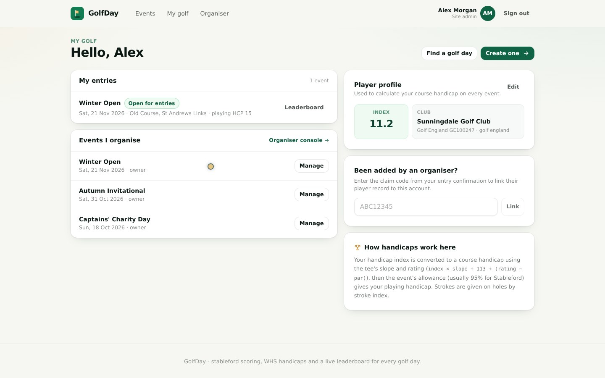

Sign in (or create an account - one email and password, no club membership needed), then
open **Societies** in the top bar.

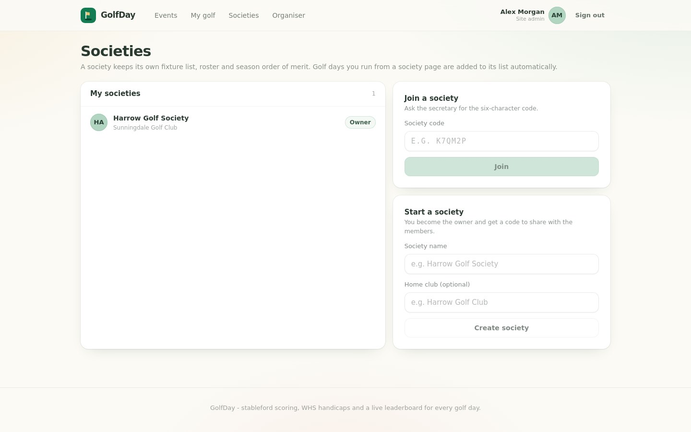

Under **Start a society**, type the name - *Harrow Golf Society* - and a home club if
there is one. Press the button. You are now the **owner** of that society, which means
you can change everything about it; anyone you invite later is a **secretary** (can run
days) or a **member** (can enter them).

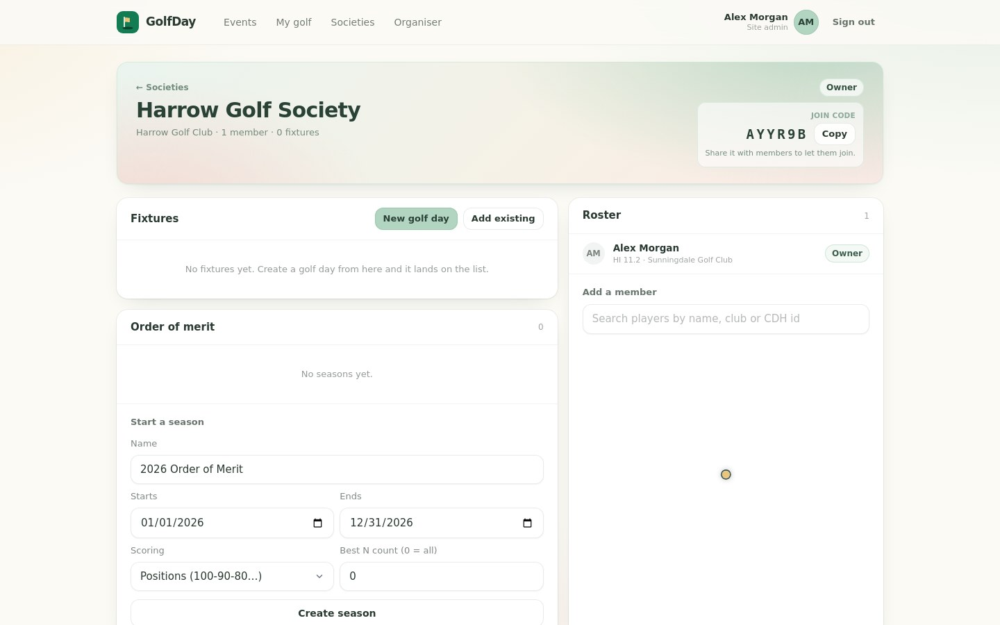

Two things on this page matter more than the rest: the **join code** (share it with the
society and they can add themselves) and the **roster**.

---

## 2. Build the roster

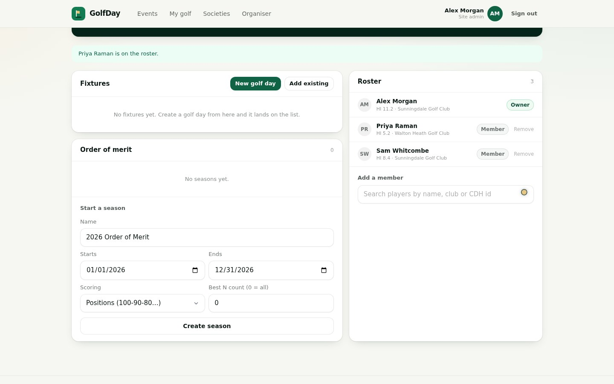

A society roster is the list of people who play your days. There are three ways to fill
it, and they mix freely:

* **They join themselves.** Send them the join code from the society page. They sign in,
  open **Societies → Join a society**, type the code, and they are on the roster with
  their own name and handicap.
* **You add them.** Under **Roster → Add a member**, search by name, home club or CDH
  number. If they already have a GolfDay account they are added; if not, you can add
  them as a person and they can claim the record later.
* **You paste a list.** Any export from a spreadsheet works - names in one column,
  handicaps in another. Rows with an unreadable handicap are reported and skipped rather
  than quietly imported wrong.

### Handicaps: where the numbers come from

Every handicap in GolfDay records **where it came from**, and the app never pretends a
number was checked when it wasn't. A player can hold any of these:

| On their profile | What it means |
| --- | --- |
| National WHS database | Official, and *verified* when your club has the union credentials |
| iGolf (no club needed) | England Golf's subscriber scheme - official, no club membership |
| Another country's system | GHIN, Golf Canada, Golf Australia - official there, verified if your club has that system's login |
| Society or committee handicap | Real, but local - shown as unofficial |
| Entered by hand | Typed in by the player or by you - shown as declared |
| No handicap yet | Plays off scratch until they have one. **Nothing is blocked** |

You choose the club's lookup source once, on the society page under **Handicaps**:
typed-in by hand, the GolfDay directory, the national WHS database, GHIN, Golf Canada,
Golf Australia, or your own endpoint. Fill in the credentials, **Save**, then press
**Test lookup** with a real number to prove it works before a competition depends on it.

> **If a lookup cannot run, it says so.** You will see "this is not configured" or a
> message from the provider - never a quiet "not found" that leaves a real handicap
> marked as merely declared. And nothing in the flow requires a golfer to belong to a
> club or a national union: "No handicap yet" and "Society or committee handicap" are
> first-class choices on every screen.

---

## 3. (Optional) Start a season

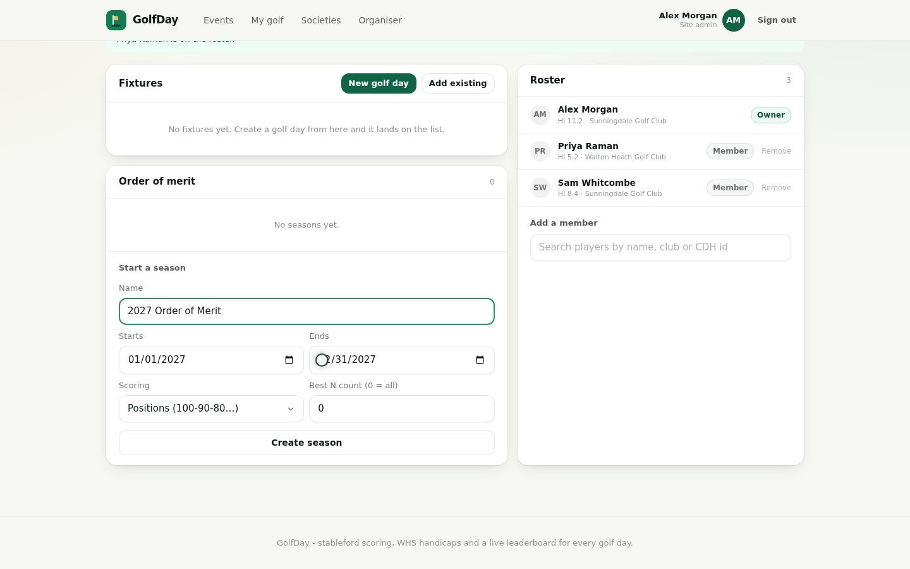

If your society plays a series of days and wants an **order of merit**, start a season on
the society page: a name, a start and end date, and how points are awarded. Days you
attach to the season score into it automatically. Skip this for a one-off outing - you
can add a season later and attach past results.

---

## 4. Create the golf day

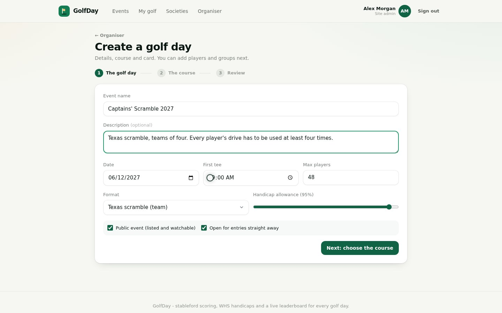

**Admin → Create a golf day** is a three-step wizard:

1. **The basics** - name, date, a one-line description, the format (Stableford, net
   stroke play, or Texas scramble), the handicap allowance (95% is common for singles
   matchplay-style days, 100% for a straightforward Stableford), and whether it belongs
   to a society.
2. **The course** - search the course library by club or town and pick a card. It copies
   par, stroke index and the tee ratings, so playing handicaps are worked out properly.
   No card? Create the event with a placeholder and add the card from the organiser
   console when you have it.
3. **Review** - check the date, card and format, then create it.

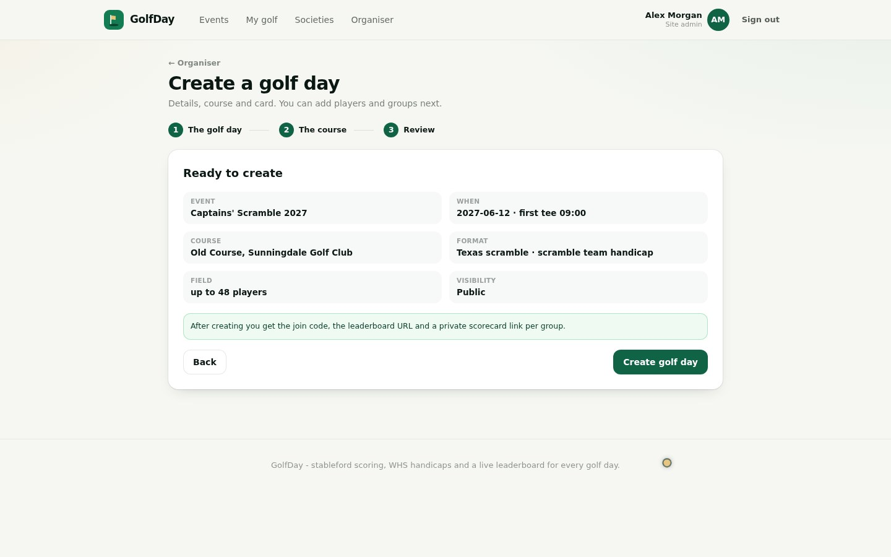

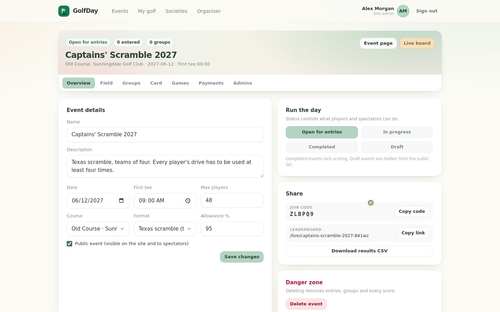

---

## 5. Fill the field

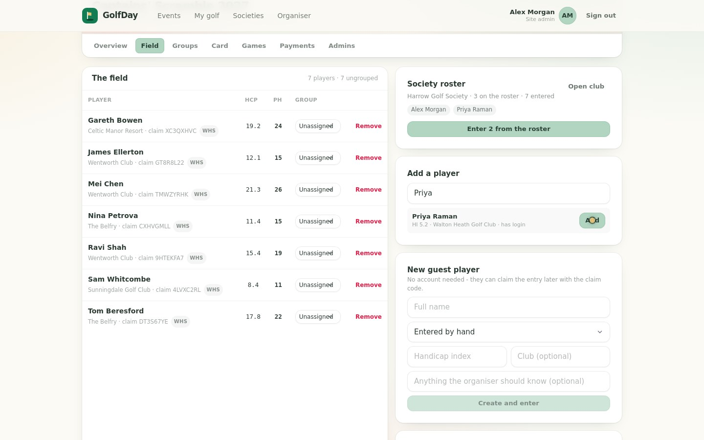

Open the event's organiser console (**Admin → the event**). The **Field** section is the
entry list:

* **From the roster** - one click per person. This is what a society roster is for: you
  are not re-typing the members every month.
* **Add a player** - anyone with a GolfDay account, by name.
* **New guest player** - someone without an account, or a visitor. Pick where their
  handicap comes from; "No handicap yet" plays them off scratch.
* **Import a CSV** - a one-off list from a spreadsheet.

Each entry keeps a snapshot of the handicap on the day, which is what makes a played
round reproducible months later.

### Tee groups and teams

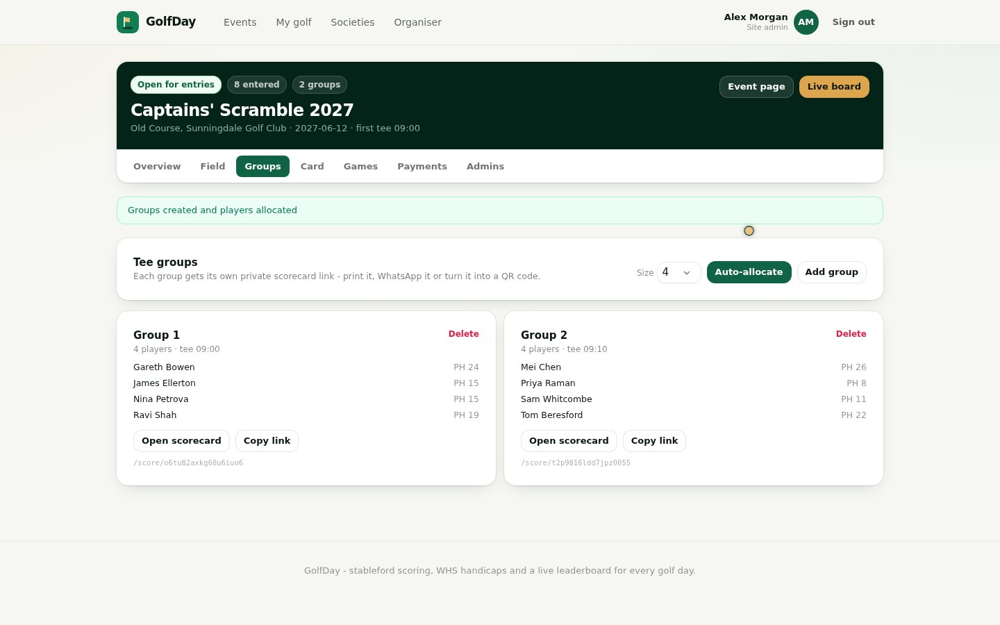

**Tee groups** puts people out in threes and fours, by hand or automatically. For a Texas
scramble, the team is the unit, and each team gets its own shareable scorecard link.

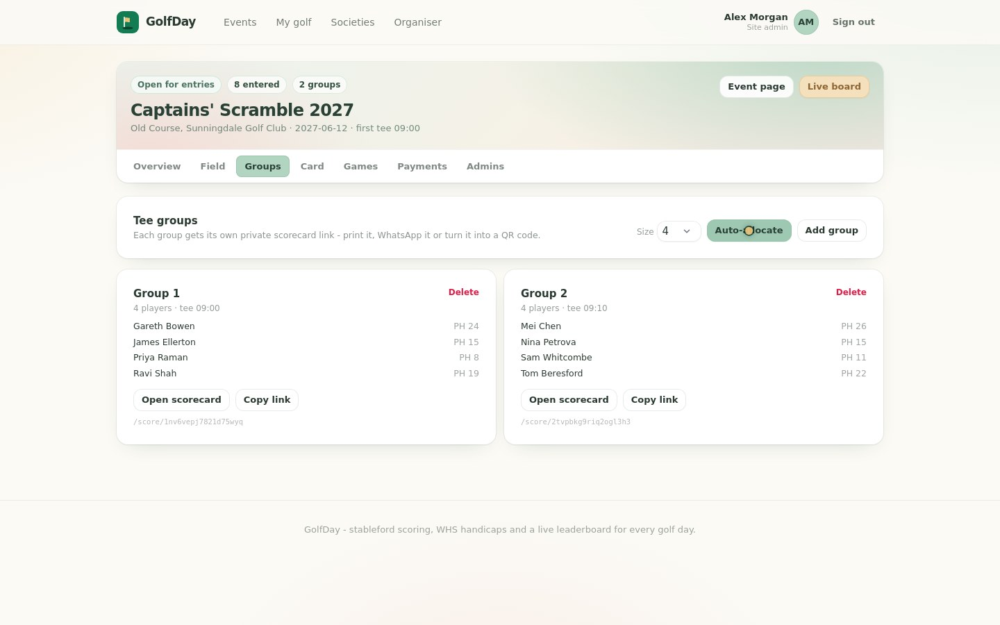

### Money (only if you are charging)

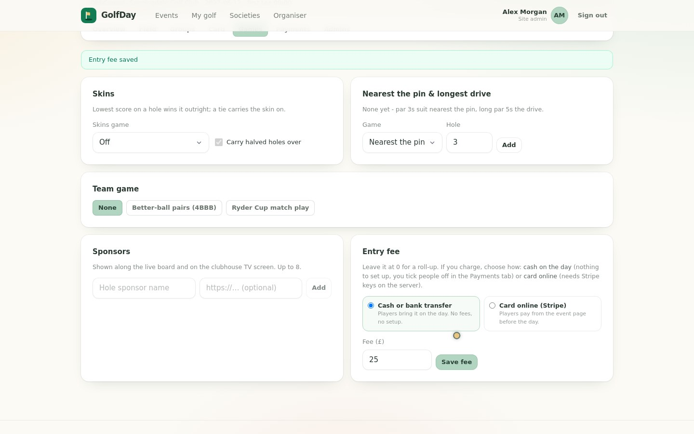

If the day has an entry fee, set it on the event. Players pay by card from their entry
page; you see who has paid, and you can refund an entry from the console without leaving
the app. Leave the fee blank for a roll-up - no payment screens appear at all.

---

## 6. Open the day

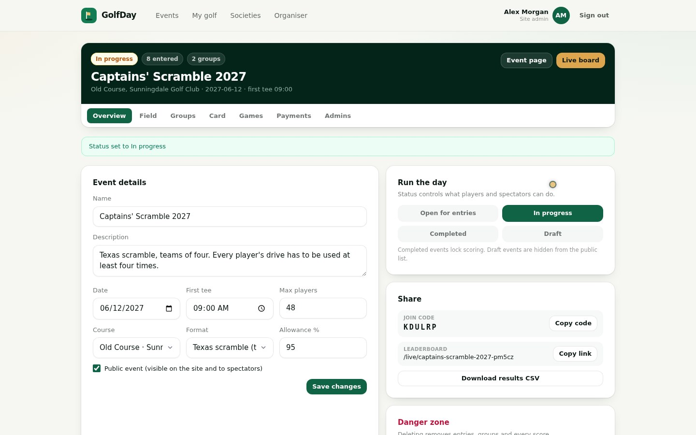

Under **Run the day**, set the status to **OPEN**. Players can now enter and see the
event; spectators can see the event page. When you are ready for scoring, set
**IN PROGRESS**; when the last card is in, **COMPLETED** locks scoring and keeps the
result.

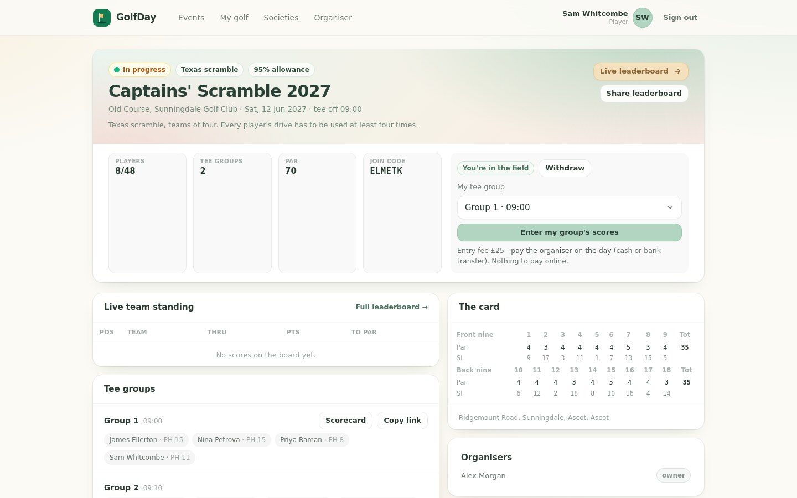

Share the **join code** (or the event link) with the field. Players sign in, enter, and
the app shows them their course handicap, playing handicap and shots received on each
hole.

---

## 7. On the day

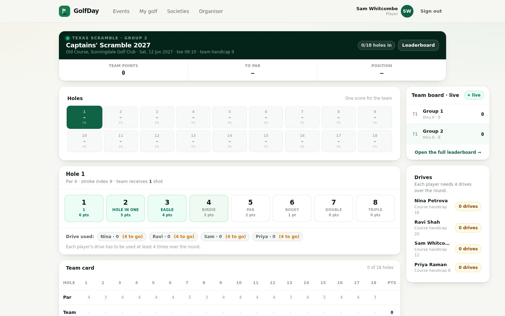

Each group opens their scorecard (from the link you shared, or from the event page) and
types gross scores hole by hole. It works on a phone in a pocket, keeps working when the
signal drops and syncs when it returns, and shows the running total and points as they
go.

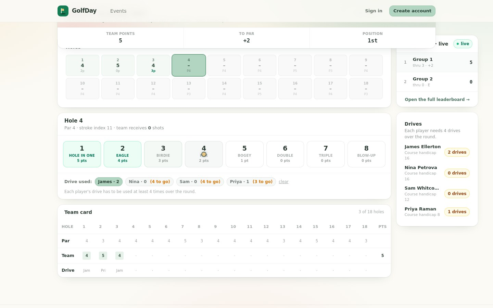

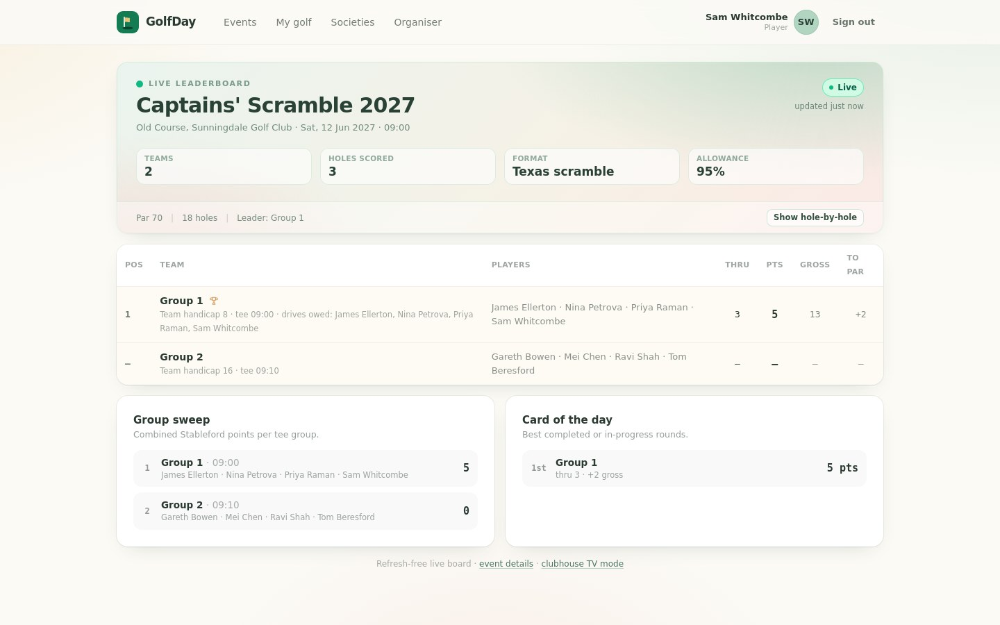

The **live board** updates as cards come in - it is the clubhouse screen, and the same
page spectators open. Nobody needs to send you a photo of a card.

---

## 8. Afterwards

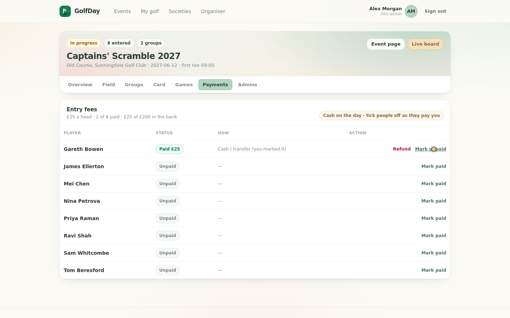

* **Payments** - who has paid, and refunds if someone dropped out.
* **Results** - final standings are on the event page and the live board.
* **Order of merit** - if the day belongs to a season, the points are already counted.

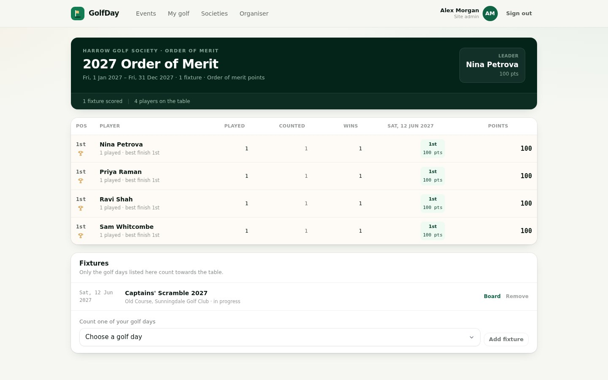

Next month you repeat from step 4: the society, roster and handicap settings stay put.

---

## If something looks wrong

| Symptom | What to do |
| --- | --- |
| A player's handicap is wrong | Open their entry in the field and edit the index; or ask them to update their profile. An organiser's number always wins for that day |
| "Not configured" when looking a handicap up | The club's lookup source has no credentials yet. Society page → **Handicaps**, or ask the player to enter the index by hand - either way the day goes ahead |
| Someone has no smartphone | Enter their scores on your own phone from the organiser console, or give the card to anyone in the group |
| A player is not on the roster | Use **New guest player** on the field; they can claim the record later |
| The join code went to the wrong group | The join code can be re-shared or rotated on the society page |
| A completed event needs a correction | A site admin can reopen it; the change is recorded against the event |

---

## Honest limits

* The **live handshake** with the national WHS platform, GHIN, Golf Canada and Golf
  Australia cannot be exercised without real credentials - the "Test lookup" button is
  how you confirm it with yours.
* Handicap indexes are personal data. They are stored on the player and snapshotted into
  the event so a played round stays reproducible.
* Everything the app cannot verify is labelled in the interface: *verified*, *declared*
  or *unofficial*. Nothing is upgraded silently.

More detail on the plumbing (course API, WHS, overseas providers, Stripe, hosting) is in
[`INTEGRATIONS.md`](INTEGRATIONS.md), [`HOSTING.md`](HOSTING.md) and
[`SIGN-IN.md`](SIGN-IN.md).
